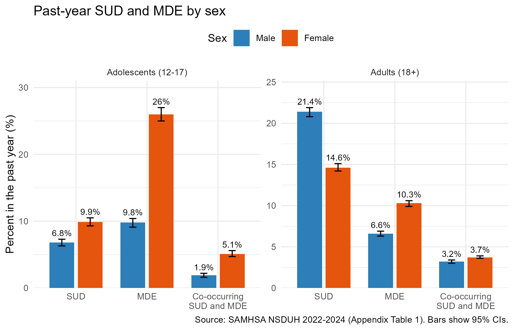
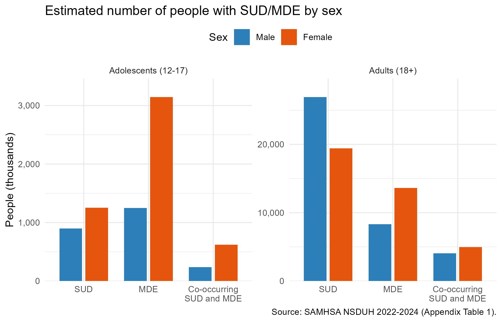
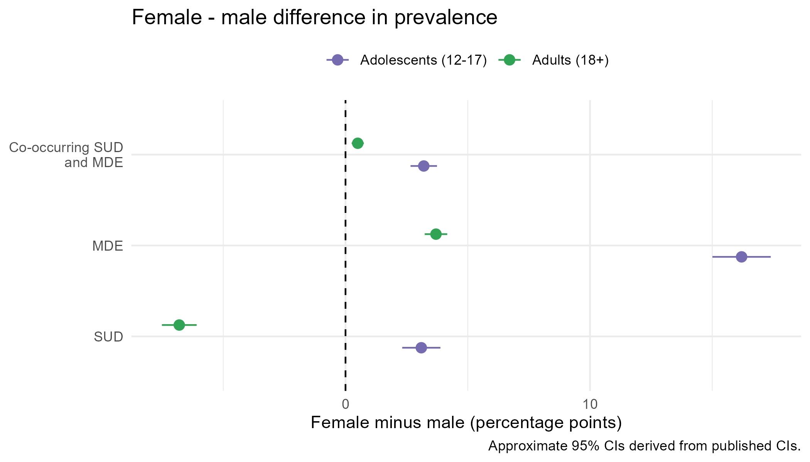

```{r setup, include=FALSE}
knitr::opts_chunk$set(echo = FALSE, warning = FALSE, message = FALSE)
source("00_requirements.R")
source("02_funct_Plots.R")
sex_data <- read_csv("data/nsduh_table1_sex.csv") %>%
  mutate(sex = factor(sex, levels = c("Male", "Female")),
         age_group = factor(age_group, levels = c("Adolescents (12-17)", "Adults (18+)")),
         outcome = factor(outcome, levels = c("SUD", "MDE", "Co-occurring SUD and MDE")))
diff_data <- compute_sex_differences(sex_data)
```

## Abstract

For our project, we will dive deeper into substance disorder rates differing among other demographics. Our data will be focused specifically on male and females in the United States, and examine which group has the higher probability than the other. Using data from the Substance Abuse and Mental Health Services Administration, we will extract and compare patterns that will conclude us to the leading difference. Collectively, our goal is to determine whether gender plays a role in substance and opioid abuse. 

## Introduction

At large, substance disorder is a lingering issue in the United States, where millions of Americans have either identified, unidentified, or rehabilitated this issue. However, data shows that certain rates differ from different backgrounds. Our goal for this project is to conclude whether a certain demographic is likely to acquire a substance disorder, compared to another.

The motivation that led us into researching the relationship with gender roles and substance abuse was due to the heavily-increased percentage of Americans reported with addiction, yearly. Through extensive research, we are hypothesizing that males have a higher risk to substance disorders than females.

With our goal in mind, we hope our conclusion will benefit healthcare workers, researchers, and other health organizations to stop the influx of people from getting heavily addicted to harmful substances. Identifying problems in different demographics will eliminate biased conclusions, gain a better understanding on the effects of addiction, and spread awareness on substance disorder prevention.


## Executive Summary

- Among adults, males have a higher past-year SUD prevalence than females
(21.4% vs. 14.6%), consistent with our original hypothesis.
- Among adolescents, the pattern is reversed: females have a higher SUD
prevalence than males (9.9% vs. 6.8%).
- Major depressive episode and co-occurring SUD and MDE are higher in females than in males in both age groups, with the largest gap in adolescent MDE (26.0% vs. 9.8%).
- Adult males account for more people with an SUD in absolute terms (about 26.9 million vs. 19.4 million adult females).
- The relationship between gender and SUD depends on age, so our hypothesis will be refined to be age-specific.

## Data
The National Survey on Drug Use and Health uses Table 1 to interpret the correlation between substance use and gender. The data includes the percentage of drug users based on sex (male and female) and age groups (12-17 years old). 

Based on the information from our graphs, adolescent and adult males score a 28.2% in substance use disorders whereas adolescent and adult females score 24.5% in substance use disorders.

With the help of bar graphs and confidence intervals, we separated gender and age of each profile. In conclusion, data shows that males have a higher rate of substance abuse compared to females. However, adult females represent a higher percentage of addiction than adult males by 3.1%. 

In order for us to collect the information based on the Substance Abuse and Mental Health Services Administration's findings, we standardized the data and checked missing and unusual values.


```{r data-table}
diff_data %>%
  transmute(`Age group` = age_group, Outcome = outcome,
            `Male (%)` = percentage_Male, `Female (%)` = percentage_Female,
            `Diff F-M (pp)` = round(diff_pp, 1),
            `Ratio F/M` = round(ratio_F_to_M, 2)) %>%
  kable(caption = "Past-year prevalence by sex, NSDUH 2022-2024")
```

## Visualization

We compared male and female past-year prevalence of SUD and MDE using the
NSDUH 2022-2024 estimates.

```{r fig1, out.width="90%", fig.align="center"}

```

**Figure 1.** Grouped bars of past-year prevalence of SUD, MDE, and co-occurring SUD and MDE for males and females, by age group, with 95% confidence intervals. Among adults, SUD is higher in males (21.4% vs. 14.6%), supporting our hypothesis. Among adolescents, females are higher for SUD (9.9% vs. 6.8%) and much higher for MDE (26.0% vs. 9.8%). The confidence intervals do not overlap in any comparison, which suggests all of these differences are real.

```{r fig2, out.width="90%", fig.align="center"}

```

**Figure 2.** Estimated number of people (in thousands) with each condition. Adult males account for about 26.9 million people with an SUD compared with 19.4 million adult females, so the higher percentage in males also means a larger absolute burden.

```{r fig3, out.width="90%", fig.align="center"}

```

**Figure 3.** Female minus male difference in prevalence, in percentage points. Points left of zero indicate higher prevalence in males. Adult SUD is the only outcome where males are clearly higher; every other outcome is higher for females.

## Analysis
Next, we want to check whether the gender differences we saw in the plots are actually real. For each age group, we'll use the confidence intervals from the NSDUH report to figure out the standard errors, then run z-tests to compare male and female rates for SUD, MDE, and both together. Since we're running a bunch of tests, we'll adjust the p-values so we don't get false positives. If we can get the full NSDUH data, we also want to build a logistic regression with gender, age group, and how they interact, and try it on opioid use too.

We expect adult males to have higher rates of SUD than adult females, and
adolescent females to be higher than adolescent males. We also think MDE will stay higher for females in both age groups. One thing to keep in mind is that the data is self-reported, so whatever we find shows a relationship, not that gender causes it.


## Summary of Individual Contribution

Kaitlynn Kong: Title and Abstract, Introduction, Data
Jacob Kim: Visualization, Executive Summary
Kathya: Analysis, and ReadMeFile

## Link To Repository
Repository: https://github.com/kathyaalc/Stats107GroupProject/settings 

